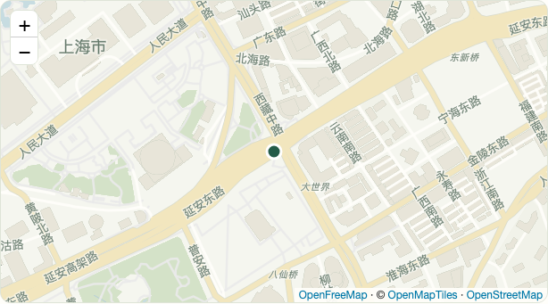
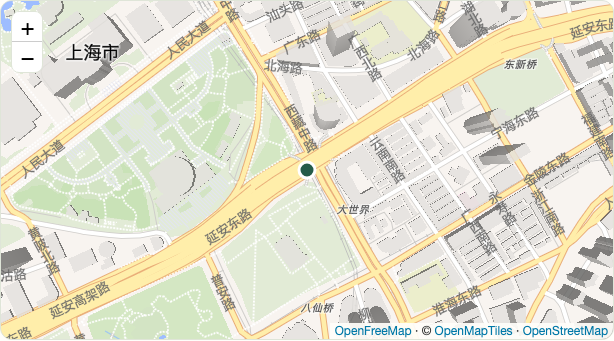
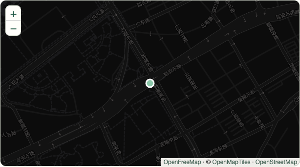

# 在这里 · Location Share

生成一个临时链接或二维码。对方打开、明确允许分享位置后，你在原页面看到一次当前位置。

**v0.4.0：链接签名、防滥用加固与代码清理。** 首页只有可选的「分享发起人」，无需创建口令或填写用途。链接固定 1 小时有效，不持续跟踪。

正式入口：[location.pizzasend.dpdns.org](https://location.pizzasend.dpdns.org)。网页和接口同域部署在 Cloudflare Workers，不依赖 `workers.dev`。验证范围见 [验证记录](docs/validation.md)。


## 使用

1. 可选填写发起人的名字，点击「生成临时链接」。
2. 把链接或页面上的二维码发给对方，保留当前页面。
3. 对方打开页面，点击「允许分享当前位置」，再按浏览器提示允许定位。
4. 浏览器估算的精度半径超过 100 米时，位置先留在本机，询问是否重新定位、仍发送大致位置或取消。100 米是产品提示阈值，不能据此判断系统的“精确位置”开关是否开启。
5. 上传成功后，对方看到发送确认。你原来的页面自动显示 OpenStreetMap 地图和定位标记。
6. 可选择通过高德、百度、Google 或苹果地图打开。位置详情默认折叠。

可以复制专属查看链接，稍后重新查看。链接持有者有查看和删除权限，请自己保存。请求过期或主动删除后，两种链接均失效，本标签页缓存的访问权限也会清理。

只有明确点击允许后才调用定位 API。打开首页、生成链接、打开分享页都不会直接采集位置。发起人名字是可选文本，不验证其真实身份。

## 精确与大致位置

页面一直以 `enableHighAccuracy: true` 请求定位，但这只是对浏览器的高精度提示，不能绕过系统权限或保证 GPS 精度。位置误差大也可能是信号较弱，不能称为伪造位置。

精度较低时，弹窗显示浏览器报告的精度半径并提供三种选择。重新获取会丢弃旧结果，再进行一次定位；若结果仍较模糊，会继续询问，不自动上传。取消或按 Esc 都不发送。大致结果必须明确选择发送；等待确认超过五分钟的结果会被拒绝，需重新获取。弹窗提供 iPhone / Android 的精确位置设置指引，网页不能替用户修改权限。

查看方始终看到估算精度；精度较低时显示明显提醒，地图缩放至能显示精度圆，中心点表示估算中心，不应当作确切位置。不会连续获取或保存轨迹。

## 地图

- 地图默认使用与网页米白、绿色配色协调的「北欧浅色」，基于 OpenFreeMap Positron 定制：浅木色建筑、浅绿公园、淡蓝水面、暖黄主路和中文优先的地名。也可以选择柔和街道、深色地图，偏好保存在本机。
- Leaflet、MapLibre、适配组件和二维码库均本地托管，不加载第三方脚本或统计。二维码在浏览器内生成，不向第三方二维码服务提交分享链接。
- 只有收到位置后才加载矢量地图组件，并向 OpenFreeMap 请求样式、地图数据、图标及部分字体字形；中文优先使用设备字体。地图署名保持可见。OpenFreeMap 基于 OpenStreetMap 数据，使用公开实例无需账号或 API 密钥。
- 浏览器不支持 WebGL2、地图组件初始化失败或新底图长时间加载失败时，自动使用原 OSM 基础瓦片，保留位置标记和精度范围。基础底图也失败时仍可通过地图 APP 打开。只请求当前视野，保留正常缓存，不预取或离线下载。
- 跨域请求只带本站 origin 作为 Referer，不发送包含访问凭据的片段网址。地图服务会看到设备网络信息和请求的地图区域。
- 底图不可用时显示提示，位置详情和四个地图选项仍可使用。大陆网络对本站和地图服务的可达性需要实测，不能保证全部运营商可访问。
- 高德使用官方 `coordinate=wgs84` 参数；百度使用 `coord_type=wgs84`，把浏览器坐标类型明确传给地图服务，避免把 WGS84 当作 GCJ02 / BD09。
- 高德使用 `callnative=1`，Google 和苹果使用地图链接。百度在手机上使用官方 `baidumap://` 协议，桌面使用网页版，并提供手动打开网页版的后备入口。能否调起 APP 取决于设备、浏览器及安装情况。

## 权限与存储

- 提交和查看使用独立角色的 HMAC-SHA-256 签名凭据（s 前缀），不能互换。请求编号包含 96 位随机数及签名保护的到期时间。伪造、篡改、混用和过期的新链接在访问存储前被拒绝；存储还会核对凭据摘要。提交权限可以读取邀请及有效期，不能读取坐标或删除位置。
- 凭据位于网址 `#` 片段，每条请求只保存 SHA-256 摘要，服务端另有私密签名密钥。打开完整链接并通过服务端验证后，当前标签页用 `sessionStorage` 保存权限并清理地址栏；存储不可用时保留完整链接。
- 一次位置快照，Durable Object 事务防止竞争覆盖。相同提交编号和内容可幂等重试，丢失发送确认时不会重复覆盖。
- 验证经纬度、精度、明确同意和时间：定位样本不得超过 5 分钟。取消后忽略晚到的定位结果。
- 查看页前台自动更新，后台暂停，返回后刷新。未收到位置时每 5 秒查询，收到后每 30 秒查询。
- 到期闹钟清理应用记录；即使闹钟延迟，过期的新签名链接也在存储访问前立即拒绝。旧链接兼容路径到达存储时也会清除过期记录。查看权限持有者可提前删除。
- HTTPS 传输，没有端到端加密；服务部署管理员可以访问存储。删除移除应用活动记录，不承诺云平台备份同时永久擦除。

创建公开开放，提供分层防护：

- JSON 正文最多 4 KiB，读取正文最多 5 秒；拒绝非法编码、跨源请求及名字中的控制/方向格式字符。已认证的非法位置提交也占用限额，不能通过报错回滚绕开限制。
- 有效创建每个来源每分钟最多 5 次，全站每天（UTC）最多 300 次，使用全局事务计数。IPv6 归并为 /64，防止轮换主机地址绕过来源额度。
- 边缘按来源每分钟限制 API 请求 120 次、创建尝试 20 次、查询 90 次、提交 15 次；每个链接的提交/查看/删除各有独立的边缘 40 次/分钟额度，减少多来源反复使用同一链接的消耗。读取额度耗尽仍有独立删除额度。
- 每条记录仅鉴权成功后消耗其查询/信息额度（各 30 次/分钟）和提交额度（8 次/分钟）。原生边缘限流按 Cloudflare 节点计数，不能当作精确全网配额。
- /api/* 经 Worker；静态页面、二维码库及地图脚本直接走静态资源服务，保留安全响应头及正常缓存。敏感 API 始终 no-store。
- 当前部署的旧版 64 位十六进制凭据仅在配置的固定迁移截止时间前兼容；兼容查询有额外节点 30 次/分钟、全局 60 次/分钟和 5000 次/UTC 日上限，到期自动关闭。新签名验证失败不会降级到旧版路径。新部署默认应将 LEGACY_CAPABILITIES_UNTIL 留空；迁移截止时间不要随每次部署延长。

公开创建仍可被攻击者占用每天的创建额度；应用限流不能承诺抵御所有 DDoS 或消除云平台请求消耗。完整发现、修复和防护边界见 [安全审查报告](docs/security-review.md)。

## 本地开发与部署

需要 Node.js 22.12 或以上：

```sh
npm ci
npm run dev
```

打开 `http://127.0.0.1:8787`。本地环境不绑定公网域名，数据保存在忽略提交的 `.wrangler/`。手机普通 HTTP 局域网访问通常不能定位，实机应使用 HTTPS。

```sh
npx wrangler login
# 首次部署：生成并安全上传服务端签名密钥，不会打印或写入仓库。
npm run signing:setup
npm run deploy
```

部署名为 `location-share` 的 Worker，独立的 SQLite Durable Objects 及限流绑定，上传 `public/`，绑定 `location.pizzasend.dpdns.org`。域名 zone 必须属于部署账号并已激活。配置关闭 `workers.dev` 和预览网址。创建口令和管理入口不再需要。签名密钥是服务端部署配置，用户无需输入。首次部署必须先设置 CAPABILITY_KEY；缺少密钥时创建失败且不会占用创建额度。重复运行 signing:setup 会轮换密钥，使现有新签名链接失效；日常更新只运行部署。旧链接仅在固定迁移窗口内兼容。

此配置只绑定 location 子域名，PizzaSend 的 `signal.pizzasend.dpdns.org` 及其 Worker 不受本项目配置修改。存储及限流独立，同账号的云平台总额度仍可能共享。不要把 Cloudflare 登录凭据提交到 GitHub。

## 验证

```sh
npm run check
npm test
npx playwright install chromium webkit
npm run test:browser
npm run build
```

测试使用隔离浏览器与模拟坐标，不采集真人位置。涵盖匿名创建、可选名字、独立解码二维码、明确同意、原页面自动收到位置、地图标记、四种地图链接、底图失败、刷新、删除、拒绝/取消、幂等重试、权限隔离、文本注入、窄屏布局与限流。自动测试拦截瓦片请求，不从 OSM 下载测试地图。WebKit 自动测试通过不等于 iPhone 实机验证。

浏览器库锁定版本并随项目在 `public/vendor/` 托管，保留许可证。npm run check 核对本地浏览器库与锁定 npm 源码一致，并检查静态/API 安全头是否同步。更新依赖后用 npm run vendor:sync 同步库文件与许可证；修改安全头后用 npm run headers:sync 更新静态配置。MapLibre 的主模块、worker 和 CSS 同源托管；适配组件只调整了浏览器模块导入路径。Chromium 集成测试启用隔离环境的软件图形渲染；不修改用户的 Chrome 设置。

## 边界

浏览器位置来源和精度由系统决定，不能保证 GPS 精度或坐标真实性。只发送一次快照，没有后台轨迹。锁屏、切换应用及网页被系统释放可能中断定位/上传。取消只阻止尚未开始上传的位置。断网不能首次加载或实时回传，网络恢复后可在原页面重试，超过五分钟需要重新定位。

## 参考

- [W3C Geolocation](https://www.w3.org/TR/geolocation/)、[iPhone 精确位置设置](https://support.apple.com/zh-cn/102647)、[Android 位置权限](https://support.google.com/pixelphone/answer/9083622?hl=zh-Hans)。

- [LocWatch](https://github.com/TatsuhiroC/locwatch)、[PizzaSend](https://github.com/TatsuhiroC/pizza-send)：项目独立实现。
- [OpenFreeMap](https://openfreemap.org/)、[MapLibre](https://maplibre.org/maplibre-gl-js/docs/)、[Leaflet](https://leafletjs.com/reference.html)、[OpenStreetMap 瓦片政策](https://operations.osmfoundation.org/policies/tiles/)。
- [高德地图标点](https://lbs.amap.com/api/uri-api/guide/mobile-web/point)、[百度地图调起](https://lbs.baidu.com/docs/webapi?title=mapadjustment/uri/web)、[Google Maps URLs](https://developers.google.com/maps/documentation/urls/get-started)、[Apple Map URLs](https://developer.apple.com/documentation/mapkit/unified-map-urls)。

MIT License. 地图组件和二维码库的许可证见 `public/vendor/`。

## 地图风格预览

以下为模拟坐标下的实际地图，没有读取真人位置。






