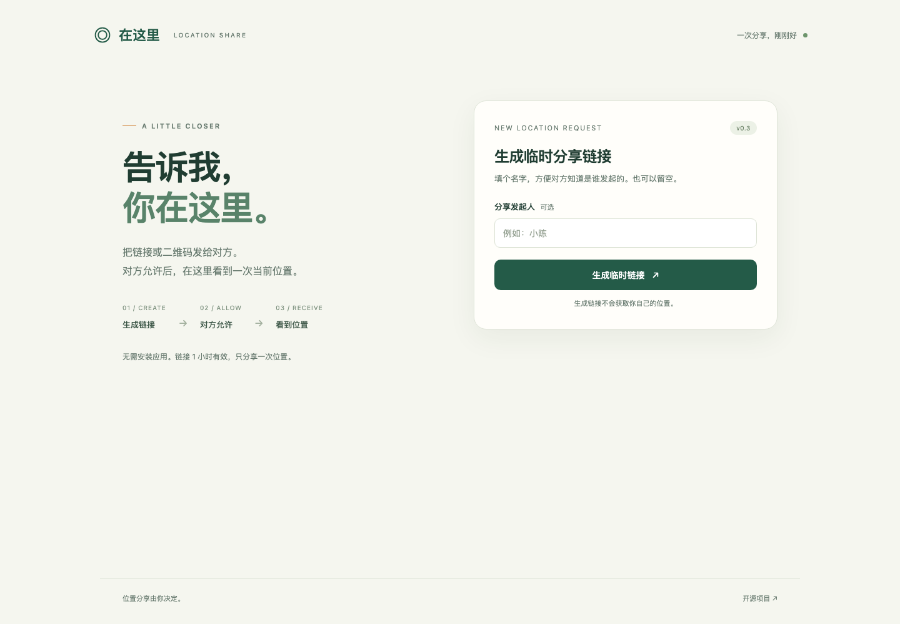

# 在这里 · Location Share

生成一个临时链接或二维码。对方打开、明确允许分享位置后，你在原页面看到一次当前位置。

**v0.3：简化流程。** 首页只有可选的「分享发起人」，无需创建口令或填写用途。链接固定 1 小时有效，不持续跟踪。

正式入口：[location.pizzasend.dpdns.org](https://location.pizzasend.dpdns.org)。网页和接口同域部署在 Cloudflare Workers，不依赖 `workers.dev`。验证范围见 [验证记录](docs/validation.md)。



## 使用

1. 可选填写发起人的名字，点击「生成临时链接」。
2. 把链接或页面上的二维码发给对方，保留当前页面。
3. 对方打开页面，点击「允许分享当前位置」，再按浏览器提示允许定位。
4. 上传成功后，对方看到发送确认。你原来的页面自动显示 OpenStreetMap 地图和定位标记。
5. 可选择通过高德、百度、Google 或苹果地图打开。位置详情默认折叠。

可以复制专属查看链接，稍后重新查看。链接持有者有查看和删除权限，请自己保存。请求过期或主动删除后，两种链接均失效。

只有明确点击允许后才调用定位 API。打开首页、生成链接、打开分享页都不会直接采集位置。发起人名字是可选文本，不验证其真实身份。

## 地图

- Leaflet 与二维码生成库本地托管，无外部脚本、字体或统计。二维码在浏览器内生成，不向第三方二维码服务提交分享链接。
- 收到位置后才请求当前视野需要的 OpenStreetMap 瓦片，保留可见版权署名和正常浏览器缓存，不预取或离线下载。
- 跨域请求只带本站 origin 作为 Referer，不发送包含访问凭据的片段网址。地图服务会看到设备网络信息和请求的地图区域。
- 底图不可用时显示提示，位置详情和四个地图选项仍可使用。大陆网络对本站和地图服务的可达性需要实测，不能保证全部运营商可访问。
- 高德使用官方 `coordinate=wgs84` 参数；百度使用 `coord_type=wgs84`，把浏览器坐标类型明确传给地图服务，避免把 WGS84 当作 GCJ02 / BD09。
- 高德使用 `callnative=1`，Google 和苹果使用地图链接。百度在手机上使用官方 `baidumap://` 协议，桌面使用网页版，并提供手动打开网页版的后备入口。能否调起 APP 取决于设备、浏览器及安装情况。

## 权限与存储

- 提交和查看是独立的 256 位随机凭据，不能互换。提交权限可以读取邀请及有效期，不能读取坐标或删除位置。
- 凭据位于网址 `#` 片段，服务端只保存 SHA-256 摘要。打开完整链接后，当前标签页用 `sessionStorage` 保存权限并清理地址栏；存储不可用时保留完整链接。
- 一次位置快照，Durable Object 事务防止竞争覆盖。相同提交编号和内容可幂等重试，丢失发送确认时不会重复覆盖。
- 验证经纬度、精度、明确同意和时间：定位样本不得超过 5 分钟。取消后忽略晚到的定位结果。
- 查看页前台自动更新，后台暂停，返回后刷新。未收到位置时每 5 秒查询，收到后每 30 秒查询。
- 到期闹钟清理应用记录；即使闹钟延迟，过期访问也立即拒绝并删除。查看权限持有者可提前删除。
- HTTPS 传输，没有端到端加密；服务部署管理员可以访问存储。删除移除应用活动记录，不承诺云平台备份同时永久擦除。

创建公开开放，同时保留输入校验、4 KiB 正文上限、同源检查及限流：有效创建每个来源每分钟最多 5 次，全站每天（UTC）最多 300 次；无效输入不消耗有效创建额度。边缘每分钟限制 API 请求 120 次、创建尝试 20 次、查询 90 次、提交 15 次。每条记录只有鉴权成功后才消耗查询/提交额度，查询额度耗尽仍可删除。Cloudflare 边缘限制按节点计数，不是精确全网总量；公开创建也意味着别人可以消耗全站创建额度。

## 本地开发与部署

需要 Node.js 22.12 或以上：

```sh
npm ci
npm run dev
```

打开 `http://127.0.0.1:8787`。本地环境不绑定公网域名，数据保存在忽略提交的 `.wrangler/`。手机普通 HTTP 局域网访问通常不能定位，实机应使用 HTTPS。

```sh
npx wrangler login
npm run deploy
```

部署名为 `location-share` 的 Worker，独立的 SQLite Durable Objects 及限流绑定，上传 `public/`，绑定 `location.pizzasend.dpdns.org`。域名 zone 必须属于部署账号并已激活。配置关闭 `workers.dev` 和预览网址。旧版本的创建口令和管理入口不再需要，旧有效分享/查看请求仍可读取。

此配置只绑定 location 子域名，PizzaSend 的 `signal.pizzasend.dpdns.org` 及其 Worker 不受本项目配置修改。存储及限流独立，同账号的云平台总额度仍可能共享。不要把 Cloudflare 登录凭据提交到 GitHub。

## 验证

```sh
npm run check
npm test
npx playwright install chromium webkit
npm run test:browser
npm run build
```

测试使用隔离浏览器与模拟坐标，不采集真人位置。涵盖匿名创建、可选名字、独立解码二维码、明确同意、原页面自动收到位置、地图标记、四种地图链接、底图失败、刷新、删除、拒绝/取消、幂等重试、权限隔离、文本注入、窄屏布局与限流。自动测试拦截瓦片请求，不从 OSM 下载测试地图。WebKit 自动测试通过不等于 iPhone 实机验证。

浏览器库锁定版本并随项目在 `public/vendor/` 托管，保留许可证。更新依赖时应同步该目录中的 Leaflet ESM/CSS 和 qrcode ESM 文件。

## 边界

浏览器位置来源和精度由系统决定，不能保证 GPS 精度或坐标真实性。只发送一次快照，没有后台轨迹。锁屏、切换应用及网页被系统释放可能中断定位/上传。取消只阻止尚未开始上传的位置。断网不能首次加载或实时回传，网络恢复后可在原页面重试，超过五分钟需要重新定位。

## 参考

- [LocWatch](https://github.com/TatsuhiroC/locwatch)、[PizzaSend](https://github.com/TatsuhiroC/pizza-send)：项目独立实现。
- [Leaflet](https://leafletjs.com/reference.html)、[OpenStreetMap 瓦片政策](https://operations.osmfoundation.org/policies/tiles/)。
- [高德地图标点](https://lbs.amap.com/api/uri-api/guide/mobile-web/point)、[百度地图调起](https://lbs.baidu.com/docs/webapi?title=mapadjustment/uri/web)、[Google Maps URLs](https://developers.google.com/maps/documentation/urls/get-started)、[Apple Map URLs](https://developer.apple.com/documentation/mapkit/unified-map-urls)。

MIT License. Leaflet 和二维码库的许可证见 `public/vendor/`。
