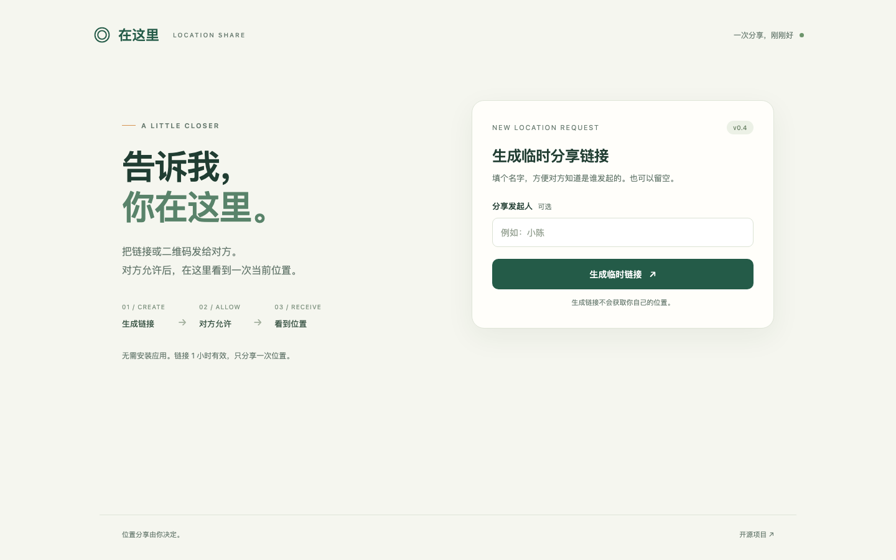

  
  <h1>Location Share · 在这里</h1>
  
A little closer. One location at a time.

  

    
    
    
  

  
<a href="README.md">简体中文</a> · <a href="README_EN.md">English</a> · <a href="https://github.com/TatsuhiroC/location-share/issues">Feedback</a>

Send a link or QR code. Once the other person explicitly agrees, their current location appears on your original page. **No installation. No continuous tracking.**

## Features

- **Links and QR codes**: an optional requester name; links expire after one hour.
- **Consent before location access**: a coarse result prompts a retry, confirmation to send it, or cancellation.
- **See it on a map**: OpenStreetMap data with Nordic light, soft street and dark styles.
- **Open a maps app**: Amap, Baidu, Google Maps and Apple Maps.
- **End it early**: the viewer can delete the record and revoke both links.

## Start in three steps

1. **Create a link.** Open the app and optionally enter the requester’s name.
2. **Send it.** Share the link or QR code and keep your original page open.
3. **Wait for consent.** After the other person opens it and allows location access, their location appears automatically.

Keep the private viewing link for later; anyone holding it can view and delete the location. The app interface is currently in Simplified Chinese.

## FAQ

**Does it need internet?** Yes. Opening the app, sending a location and loading maps require a connection.

**Is the location always accurate?** No. Accuracy depends on the device, system permissions and signal. The page shows an estimated range and offers precise-location setup tips; it cannot guarantee GPS accuracy or authentic coordinates.

**Is the location public?** The site does not list locations publicly; viewing requires the private link. Locations reach the server over HTTPS without end-to-end encryption, so the deployment administrator can access stored data. A background task clears active records after expiry. Map providers see network information and the requested area.

[Development & deployment](docs/development.en.md) · [Security review (中文)](docs/security-review.md) · [Validation & more screenshots (中文)](docs/validation.md)

## Credits

Built with [OpenStreetMap](https://www.openstreetmap.org/copyright), [OpenFreeMap](https://openfreemap.org/), [Leaflet](https://leafletjs.com/) and [MapLibre](https://maplibre.org/). Inspired by [LocWatch](https://github.com/TatsuhiroC/locwatch) and [PizzaSend](https://github.com/TatsuhiroC/pizza-send); implemented independently.

[MIT](LICENSE) · Copyright © 2026 TatsuhiroC · Third-party licenses: [public/vendor](public/vendor/)
