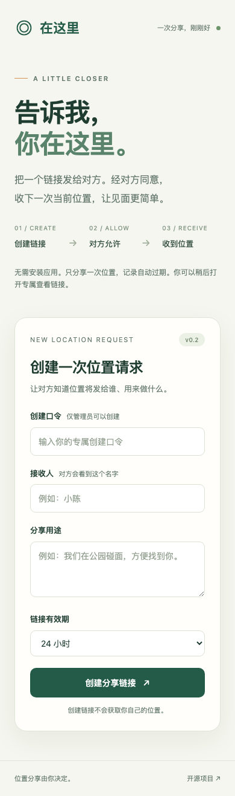

# v0.2 验证范围

验证日期：2026-10-14（Asia/Shanghai）。

## 正式部署

- 正式网址：<https://location.pizzasend.dpdns.org>。
- Cloudflare Worker：`location-share`，版本 `31dde05f-6753-44e0-90e0-e57c90e4e9cf`。
- `workers.dev` 及预览网址关闭；网页和 `/api/` 通过同一自定义域名提供。
- 部署后核对：`signal.pizzasend.dpdns.org` 仍绑定 `pizza-send-signal`；新 location 子域名绑定 `location-share`。数据库及限流绑定独立。
- 生产创建口令为单独生成的随机凭据，仅把摘要存入 Cloudflare Secret，不使用公开的测试口令，不提交私有管理入口到 GitHub。
- GitHub 实现提交 `3db93cc` 的自动检查已通过，包含语法检查、9 项状态测试、18 项 Chromium/WebKit 测试和部署打包。

## 公网接口验证

在当前机器网络上使用模拟坐标 `(0, 0)` 验证，没有采集真人位置：

| 检查 | 实际结果 |
| --- | --- |
| HTTPS 健康检查 | 200，版本 0.2.0 |
| 无管理权限创建 | 401 |
| 管理权限创建 | 201 |
| 分享权限提交模拟位置 | 200 |
| 查看权限读取位置 | 200，坐标与精度一致 |
| 分享权限尝试读取位置 | 401 |
| 查看权限删除验证记录 | 200 |
| 删除后再次读取 | 404 |

Chrome 已直接打开正式 HTTPS 页面，确认前端正常渲染。测试记录已清理。当前网络验证不等于大陆无 VPN 或三大运营商的实机可达性验证。

## 已通过

- JavaScript 语法检查。
- 9 项状态与权限测试：提交/查看隔离、事务竞争、幂等重试、过期清理、主动删除、坐标与时间校验、元信息输入验证、创建权限以及记录读取限额耗尽后的删除。
- 18 项浏览器与真实本地 Worker 集成测试：Chromium 9 项、WebKit 9 项全部通过。
- Wrangler 的部署打包预检，包含静态资源和两个 SQLite Durable Object 绑定。
- 1440 像素桌面与 390 像素手机全页截图人工检查；375 像素布局自动检查无水平溢出。

浏览器测试中的完整流程使用相互隔离的两个浏览器上下文：

1. 创建请求并得到两个权限不同的链接。
2. 仅打开分享页时，没有任何位置提交。
3. 明确点击分享，浏览器定位 API 返回受控坐标。
4. 接收服务确认保存后才显示成功。
5. 查看方收到同一坐标、精度和时间；刷新后仍可查看。
6. 主动删除后，分享与查看权限均失效。

其他场景覆盖拒绝定位、取消后的晚到回调、服务已收到但客户端丢失确认后的幂等重试、伪造查看凭据、角色凭据互换、跨来源删除、非法坐标、过大的请求体、已使用链接、注入文本和创建限流。v0.2 还验证未授权创建、无效创建输入不消耗有效创建配额，专属管理入口清理地址栏及刷新/退出权限。

WebKit 测试返回的 `GeolocationPosition.timestamp` 使用微秒；浏览器端只在微秒转换后得到合理的新鲜时间时转换为毫秒。不会用当前时间覆盖过期样本。Chrome 与 WebKit 的发送及重试流程均已验证。

## 尚未验证

- 真实 iPhone 和 Android 的系统定位权限、真实 GPS 精度、内置浏览器、锁屏后页面释放。
- 跨设备、不同地区网络访问，尤其大陆无 VPN 的电信/联通/移动网络。
- 真实云端清理闹钟在一小时或一天后触发；过期访问立即删除活动记录的逻辑已有测试，但不据此承诺云平台备份的同步擦除。
- 全站创建每日配额耗尽和高并发负载；创建来源分钟限流及失败请求隔离已有集成测试。Cloudflare 边缘限流按节点计数，不是精确全网总量。

自动化坐标是测试数据，没有读取真人位置。WebKit 的通过结果不是 iPhone 实机测试。

## 预览

