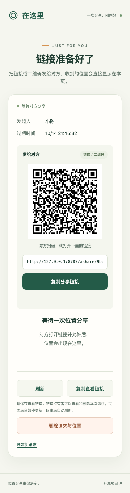
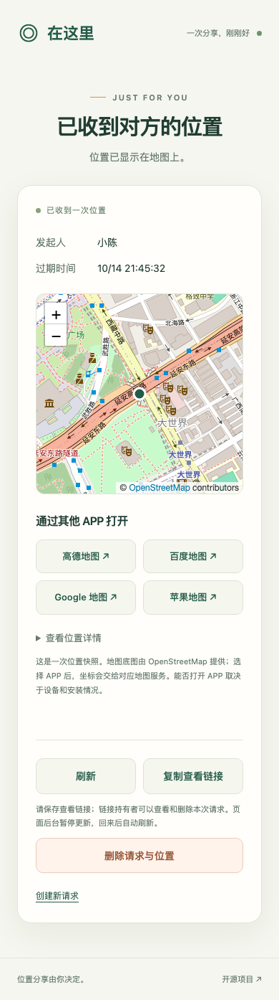
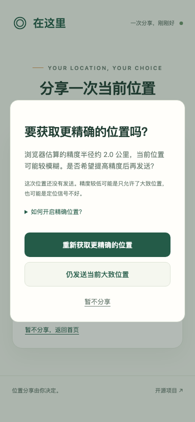
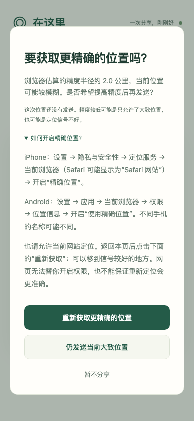
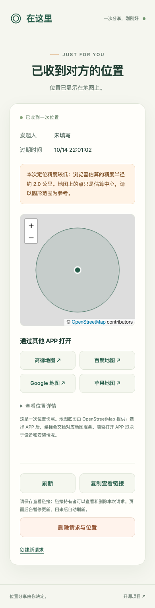
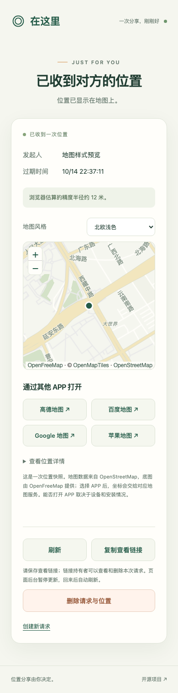

# v0.4.0 验证范围

验证日期：2026-10-14（Asia/Shanghai）。

## 正式部署

- 正式网址：<https://location.pizzasend.dpdns.org>，版本 0.4.0。
- Cloudflare Worker：`location-share`，部署版本 `4fcbcb5d-6b35-4fcc-9aa9-a1c8f749128b`（代码发布 `44b48360-0105-4dcd-92f0-73b3b98fdac2`，随后清理废弃配置）。
- `workers.dev` 及预览网址关闭，网页与 API 同域。
- 已核对 `signal.pizzasend.dpdns.org` 仍绑定 `pizza-send-signal`，location 子域名绑定 `location-share`。本次没有修改 PizzaSend 的配置。
- Chrome 已打开正式页面，确认首页只有可选的发起人字段，没有创建口令、用途或有效期选择。

## 公网接口验证

当前机器网络使用模拟坐标 `(0, 0)`，没有采集真人位置。测试记录已删除。

| 检查 | 实际结果 |
| --- | --- |
| HTTPS 健康检查 | 200，版本 0.4.0 |
| 不带创建凭据、不填名字创建 | 201 |
| 固定有效期 | 3600000 毫秒（1 小时），忽略客户端的 24 小时字段 |
| 分享权限提交模拟位置 | 200 |
| 查看权限读取 | 200，坐标与精度一致 |
| 分享权限尝试读取位置 | 401 |
| 查看权限删除测试记录 | 200 |
| 删除后再次读取 | 404 |
| 新凭据格式 | s 前缀及 256 位签名 |
| 伪造新凭据 / 篡改编号 | 401 / 401 |
| 升级前创建的旧链接 | 读取 200，删除 200，删除后 404 |
| 静态页面响应头 | no-cache，CSP 及其他安全头保留 |
| API 响应头 | no-store |

## 已通过

- JavaScript 语法检查和部署打包；更新已成功部署。
- 20 项状态/安全测试：原有权限、并发、幂等、清理与输入验证；新增签名伪造/到期/角色混用在存储前拒绝、旧凭据迁移截止/预算、缺少签名密钥时无状态写入、IPv6 归并、慢速输入超时、按链接及独立删除额度、非法提交占用额度和双向格式字符校验。
- 40 项浏览器及真实本地 Worker 集成测试：Chromium 20 项、WebKit 20 项全部通过。新增缓存污染保护、静态资源绕过 Worker 后的安全头、极区坐标回退。
- 桌面 1440 像素和手机 390 像素截图人工检查，375 像素手机布局自动检查。
- 本地预览以模拟坐标展示实际 OSM 底图和定位标记，未出现页面 JavaScript 异常。只查看一个视野，没有平移/缩放扫描或离线预取。

浏览器完整流程使用两个隔离上下文：匿名创建，实际渲染二维码，独立 QR 解码器验证二维码等于分享链接，打开分享页时没有提交，明确点击允许后定位并发送，原生成页面自动收到位置，无需重新打开或手动刷新。地图显示定位点和精度范围，标明 OSM 版权；验证四个地图地址的坐标顺序及 WGS84 参数。刷新后位置仍可查看，主动删除后链接失效。

其他覆盖：定位拒绝、取消后的晚到回调、已收到但丢失确认后的幂等重试、权限互换/伪造、跨源删除、非法坐标、正文大小限制、文本注入、可选空名字、固定一小时、底图失败时保留 APP 选项、手机百度原生链接、五次创建来源限额、无效输入不占有效创建额度。

自动测试拦截 OSM 瓦片，不下载第三方测试地图；测试 API/浏览器来源隔离，避免不同测试互相占用限额。限流场景单独使用固定测试来源。GitHub 自动验证运行相同的语法、状态、浏览器和部署打包检查。

## 安全审查更新

- 全部业务源码、配置及脚本重新审查，发现和修复详见 [安全审查报告](security-review.md)。
- npm audit 未报告已知依赖漏洞；语法、vendor 完整性、安全头一致性及部署打包通过。
- 正式服务配置私密 CAPABILITY_KEY，使用 stdin 上传，不输出密钥、不写入仓库。旧 CREATOR_KEY_HASH 在新版公网验证通过后清理。
- 旧链接固定迁移截止时间：2026-10-15T14:21:09.675Z（北京时间 2026-10-15 22:21:09），到期自动禁用旧路径，不随未来部署延长。
- /api/* 经 Worker，静态资源直接走 Assets；公网确认静态 no-cache 与 CSP，API no-store。
- 旧版上线前生成的模拟记录在升级后验证读取/删除；新签名链接验证创建、伪造/篡改/权限混用拒绝、模拟位置发送及删除后失效。两条测试记录均清理。
- 未进行生产压力攻击，未修改 zone 全局规则或 PizzaSend Worker。

## 精度确认更新

- 模拟精度半径 2000 米时，弹窗打开前后均没有位置 POST，服务端仍为等待状态；只有明确选择“仍发送当前大致位置”才发送。
- 重新定位得到精度 12 米的新坐标时，服务只收到新结果；重试后仍为 2000 米会再次询问，不自动发送。
- 点击“暂不分享”或 Esc 均关闭弹窗并清空待发送结果，服务端没有位置。
- 等待确认超过五分钟的样本不发送；原有网络确认丢失的幂等重试仍正常。
- 查看方显示“定位精度较低”和误差半径，地图缩放展示精度范围，避免把估算中心看作准确定位。
- 390 像素手机弹窗及设置指引截图已人工检查；没有页面异常，样本和地图瓦片为测试模拟，不采集真人位置。
- 100 米是本项目的提醒阈值，不是系统权限状态的判断标准。网页无法打开系统的精确位置开关，开启后也不保证实际定位一定准确。

## 北欧地图更新

- 默认风格基于 OpenFreeMap Positron 定制，配合网页米白、绿色：浅木色建筑、浅绿公园、淡蓝水域和暖黄主路，优先显示本地地名，避免重复的拼音行。
- 同一模拟地点实际比较「北欧浅色」「柔和街道」「深色地图」，字体、道路、绿色位置点和 OSM / OpenMapTiles / OpenFreeMap 署名均可见。
- 只有收到位置后加载本地 MapLibre 组件及第三方底图资源，主页和等待分享时不请求新底图。worker 和组件脚本同源，不启用外部脚本或 eval。
- 主题选择保存在本机；Chromium 和 WebKit 验证主题实际切换、GL 画布像素变化、刷新保留偏好，同时位置点和精度圆保持可见。
- 无 WebGL2 时立即回退到 OSM 基础底图；新底图加载超过 12 秒或初始化失败时也会回退。原有完整流程验证新底图失败、基础底图也失败时仍能通过 APP 打开位置。
- Chromium 测试只在隔离浏览器启用软件图形渲染，不调整用户的 Chrome 设置。自动测试拦截矢量样式、瓦片和字体，不使用第三方生产地图测试数据。
- 已在当前网络的正式 HTTPS 网站验证三个真实风格的渲染和切换，地图脚本无异常；云平台自动插入的统计脚本被本站 CSP 阻止，不影响地图。测试使用模拟坐标并清理记录，不是大陆无 VPN 实测。

## 尚未验证

- iPhone / Android 实机的定位权限、真实 GPS 精度、内置浏览器、扫码体验及地图 APP 调起。WebKit 自动测试通过不等于 iPhone 实机验证。
- 大陆无 VPN、不同地区及电信/联通/移动网络对本站、OSM 和四个地图服务的可达性。当前机器网络成功不代表这些网络均成功。
- 一小时后云端清理闹钟真实触发；过期访问立即删除活动记录已有状态测试，不承诺云平台备份同时永久擦除。
- 全站每日额度耗尽和高并发负载。Cloudflare 边缘限流按节点计数，公开创建可被别人占用全站创建额度。

## 预览

## 新地图预览

以下为模拟坐标下的正式网站地图：

